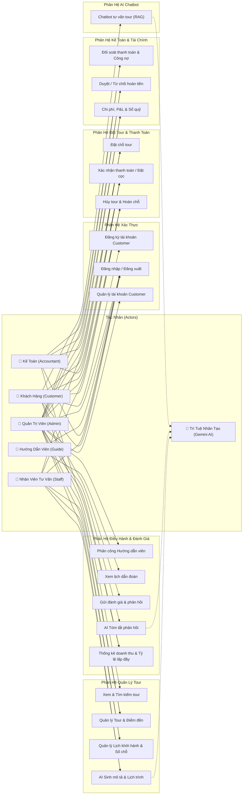
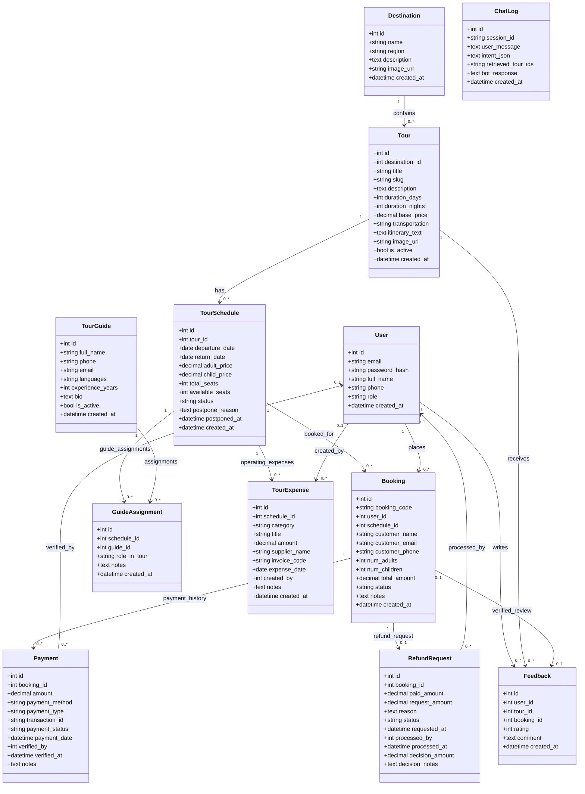
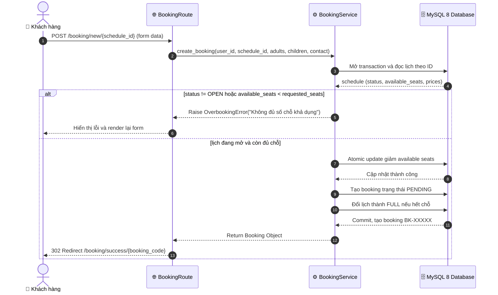
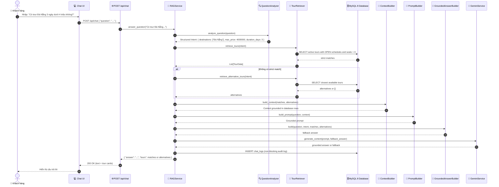
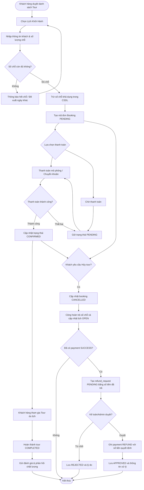
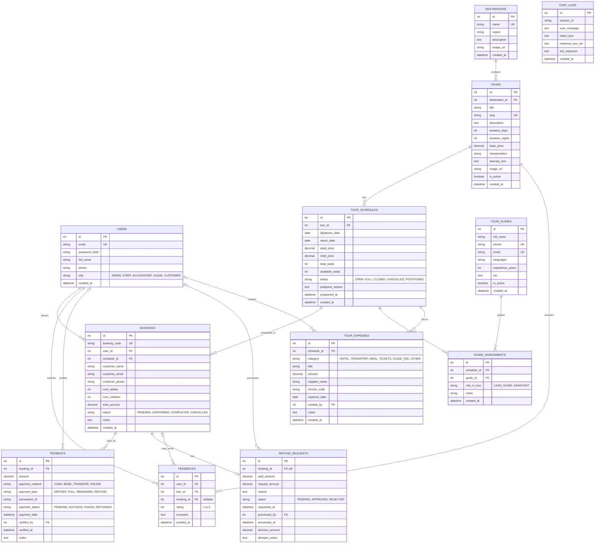

# Tài Liệu Thiết Kế Biểu Đồ & Bảng UML (UML Diagrams Specification)

Tài liệu này mô hình hóa **trạng thái triển khai hiện tại (as-built)** của hệ thống quản lý tour du lịch tích hợp AI (Đề tài 17), gồm: Use Case Diagram, Class Diagram, Sequence Diagrams, Activity Diagrams và Entity-Relationship Diagram (ERD). Các quyền và luồng được đối chiếu với Flask routes, service và MySQL schema đang có.

---

## 1. Biểu đồ Use Case (Use Case Diagram)

### 1.1 Sơ đồ tổng quan phân hệ và tác nhân

> **Phạm vi as-built:** hệ thống hiện có đăng ký công khai cho `CUSTOMER`, đăng nhập/đăng xuất cho mọi vai trò và màn hình Admin quản lý tài khoản khách hàng. Chưa có route/trang để người dùng tự cập nhật hồ sơ cá nhân, nên use case này không được thể hiện như một chức năng đã triển khai.

### 1.2 Bảng mô tả chi tiết các Use Case chính

| Mã Use Case | Tên Use Case | Tác nhân chính | Tiền điều kiện | Hậu điều kiện |
|---|---|---|---|---|
| `UC-01` | Đặt chỗ tour (Booking) | Khách hàng; Staff/Admin theo quyền hỗ trợ booking | Đã chọn đợt khởi hành `OPEN` và còn chỗ (`available_seats > 0`) | Tạo bản ghi booking, giảm số chỗ trống tương ứng |
| `UC-02` | Hủy đặt chỗ (Cancel Booking) | Khách hàng sở hữu đơn; Staff/Admin qua quản lý booking | Đơn ở trạng thái PENDING hoặc CONFIRMED | Đơn chuyển CANCELLED, hoàn trả số chỗ; tạo phiếu báo hoàn nếu đã thanh toán |
| `UC-03` | Chatbot tư vấn tour (RAG) | Khách hàng | Người dùng nhập câu hỏi tự nhiên | Chatbot trả lời thông tin chính xác từ CSDL, không bịa |
| `UC-04` | AI sinh mô tả tour | Nhân viên / Admin | Nhân viên nhập điểm đến, từ khóa | AI sinh đoạn văn mô tả chuẩn SEO và lịch trình chi tiết |
| `UC-05` | AI tóm tắt phản hồi | Admin | Đã có các phản hồi đánh giá trong CSDL | AI sinh báo cáo tổng hợp ưu/nhược điểm dịch vụ |
| `UC-06` | Ghi nhận thanh toán / đặt cọc | Khách hàng (đơn của mình), Kế toán, Admin | Booking tồn tại; khách chỉ thao tác trên đơn của mình | Có bản ghi payment; booking được xác nhận khi thanh toán thành công hoặc kế toán duyệt giao dịch |
| `UC-07` | Xử lý hoàn tiền hủy tour | Kế toán / Admin | Booking đã `CANCELLED`, có `refund_request` PENDING và giao dịch thanh toán thành công | Phiếu hoàn được APPROVED/REJECTED; khi duyệt sinh payment loại `REFUND` không vượt quá số tiền thực đã thanh toán |
| `UC-08` | Quản lý tài chính theo đoàn | Kế toán / Admin | Người dùng có quyền vào phân hệ kế toán | Đối soát giao dịch, ghi nhận công nợ/chi phí, xem P&L và sổ quỹ |

### 1.3 Đặc tả luồng Use Case trọng yếu

#### UC-06 — Ghi nhận thanh toán / đặt cọc
- **Tác nhân:** Khách hàng (đơn của chính mình), Kế toán, Admin.
- **Tiền điều kiện:** Booking tồn tại; người thao tác được phân quyền phù hợp.
- **Luồng chính:**
  1. Người dùng chọn phương thức thanh toán và số tiền thanh toán/đặt cọc.
  2. Hệ thống tạo bản ghi `payments` với `payment_type` (`DEPOSIT`, `FULL` hoặc `REMAINING`) và trạng thái giao dịch.
  3. Nếu giao dịch `SUCCESS`, booking chuyển từ `PENDING` sang `CONFIRMED`.
  4. Với chuyển khoản ở trạng thái `PENDING`, Kế toán đối soát, cập nhật `verified_by`, `verified_at`, `payment_status = SUCCESS`; booking được xác nhận khi có tiền thanh toán thành công.
- **Ngoại lệ:** số tiền không lớn hơn 0; không tìm thấy booking; thao tác trên booking không thuộc khách hàng; giao dịch đã được duyệt trước đó.
- **Hậu điều kiện:** lịch sử thanh toán được lưu, trạng thái booking phản ánh kết quả duyệt.

#### UC-07 — Hủy tour và xử lý hoàn tiền
- **Tác nhân:** Khách hàng (hủy đơn của mình), Staff/Admin (đổi trạng thái booking sang hủy), Kế toán/Admin (hoàn tiền).
- **Tiền điều kiện:** booking ở `PENDING` hoặc `CONFIRMED`; booking `COMPLETED` không được hủy.
- **Luồng chính:**
  1. Hệ thống chuyển booking sang `CANCELLED` và hoàn số hành khách về lịch khởi hành.
  2. Kế toán xem booking đã hủy cùng tổng tiền đã thanh toán thành công.
  3. Hệ thống đề xuất tỷ lệ hoàn: từ 7 ngày trước khởi hành là 90%, từ 3 đến 6 ngày là 50%, dưới 3 ngày là 0%.
  4. Kế toán xác nhận số tiền hoàn không vượt quá số tiền đã trả còn lại.
  5. Hệ thống lưu payment loại `REFUND`, trạng thái `SUCCESS`, người duyệt và thời điểm duyệt.
- **Ngoại lệ:** khách hủy booking của người khác; hủy booking đã hoàn thành; hoàn vượt quá số tiền đã thanh toán hoặc số tiền còn có thể hoàn.
- **Hậu điều kiện:** chỗ được hoàn trả chính xác; dòng tiền hoàn được lưu để phục vụ công nợ, sổ quỹ và P&L.

---

## 2. Biểu đồ Lớp (Class Diagram)

> **Phạm vi và cách đọc:** mã nguồn Flask hiện tại không khai báo các lớp entity/ORM riêng; dữ liệu được đọc từ MySQL qua adapter và được chuẩn hóa thành `dict`/`Row` trước khi xử lý bởi các lớp service tĩnh. Vì vậy, sơ đồ 2.1 là **mô hình lớp miền** ánh xạ 1-1 với `database/schema.sql`; sơ đồ 2.2 thể hiện các **lớp thực thi** trong thư mục `services/` và các phụ thuộc chính của chúng.

### 2.1 Mô hình lớp miền

**Ràng buộc miền quan trọng:**

- `TourSchedule.available_seats` luôn nằm trong `[0, total_seats]`; chỉ lịch `OPEN` mới nhận đặt chỗ.
- `Booking` có các trạng thái `PENDING`, `CONFIRMED`, `COMPLETED`, `CANCELLED`; việc hủy hoàn chỗ về lịch khởi hành.
- `Payment.payment_type` gồm `DEPOSIT`, `FULL`, `REMAINING`, `REFUND`. Thanh toán thành công không phải `REFUND` xác nhận booking.
- Mỗi `Booking` có tối đa một `RefundRequest`; yêu cầu được duyệt sinh một `Payment` kiểu `REFUND`.
- `Feedback.booking_id` có thể rỗng theo schema, nhưng nghiệp vụ chỉ cho đánh giá một lần trên booking đã `COMPLETED`.
- `users.role = GUIDE` và hồ sơ `tour_guides` hiện chưa có khóa ngoại liên kết trực tiếp; các trang Guide chỉ đọc danh sách phân công/khách theo dữ liệu phân công hiện có.

### 2.2 Các lớp service và phụ thuộc thực thi

```mermaid
classDiagram
    class AuthService {
        +register_user(email, password, full_name, phone, role) dict
        +login_user(email, password) dict
        +get_user_by_id(user_id) dict
        +update_customer(user_id, full_name, phone, email, password) dict
    }
    class TourService {
        +get_tours(filters) list
        +create_tour(...) int
        +update_tour(...) void
        +sync_schedule_prices(tour_id, base_price) int
        +create_schedule(...) int
        +update_schedule(...) void
        +postpone_schedule(schedule_id, reason) void
        +resume_schedule(schedule_id) void
    }
    class BookingService {
        +create_booking(...) dict
        +cancel_booking(booking_id, user_id, reason) bool
        +update_booking_status(booking_id, status) bool
        +get_user_bookings(user_id) list
    }
    class PaymentService {
        +record_payment(...) int
        +get_payments_by_booking(booking_id) list
    }
    class RefundService {
        +create_request(booking_id, reason, amount) dict
        +approve_request(request_id, approver_id, amount, notes) bool
        +reject_request(request_id, approver_id, notes) bool
        +get_policy_percent(departure_date) int
    }
    class GuideService {
        +create_guide(...) int
        +assign_guide(schedule_id, guide_id, role, notes) int
        +get_assignments(guide_id) list
        +get_assigned_group_customers() list
    }
    class FeedbackService {
        +create_feedback(...) int
        +has_reviewed_booking(booking_id) bool
        +update_feedback(...) bool
        +delete_feedback(...) bool
    }
    class AccountingService {
        +get_payment_reconciliation_list(status) list
        +confirm_payment(payment_id, accountant_id) bool
        +get_booking_debt_list() list
        +record_debt_payment(...) bool
        +record_tour_expense(...) int
        +get_tour_expenses(schedule_id) list
        +get_schedule_pnl(schedule_id) dict
        +get_cashflow_summary(...) dict
        +process_refund(booking_id, refund_amount, accountant_id, notes) bool
    }
    class AnalyticsService {
        +get_dashboard_stats() dict
        +get_top_selling_tours(limit) list
        +get_occupancy_rates(filter) list
    }
    class RAGService {
        +answer_question(question, session_id, role) dict
    }
    class QuestionAnalyzer {
        +analyze_question(question) dict
        +is_feedback_summary_question(question) bool
    }
    class TourRetriever {
        +retrieve_tours(intent, limit) list
        +retrieve_alternative_tours(intent, limit) list
    }
    class ContextBuilder {
        +build_context(tours, alternatives) string
    }
    class PromptBuilder {
        +build_prompt(question, context) string
    }
    class GroundedAnswerBuilder {
        +build(question, intent, tours, alternatives) string
    }
    class GeminiService {
        +is_configured() bool
        +generate_content(prompt, temperature, fallback_answer, timeout) string
    }
    class AIContentService {
        +generate_tour_description(...) dict
        +summarize_feedbacks(feedbacks) string
    }
    class ImageUploadService {
        +save(file) string
    }

    BookingService ..> RefundService : creates request
    RefundService ..> AccountingService : records refund
    RAGService ..> QuestionAnalyzer : analyzes
    RAGService ..> TourRetriever : retrieves
    RAGService ..> ContextBuilder : builds context
    RAGService ..> PromptBuilder : builds prompt
    RAGService ..> GroundedAnswerBuilder : fallback
    RAGService ..> GeminiService : generates answer
    RAGService ..> FeedbackService : reads feedback
    RAGService ..> AIContentService : summarizes feedback
    AIContentService ..> GeminiService : generates content
```

---

## 3. Biểu đồ Trình tự (Sequence Diagrams)

### 3.1 Quy trình Đặt tour & Kiểm soát số chỗ (Booking & Capacity Control)

### 3.2 Quy trình Chatbot RAG Tư vấn Tour (Zero Hallucination)

---

## 4. Biểu đồ Hoạt động (Activity Diagram)

### Vòng đời Đặt tour - Thanh toán - Hủy tour

---

## 5. Biểu đồ Thực thể Liên kết (Entity-Relationship Diagram - ERD)

